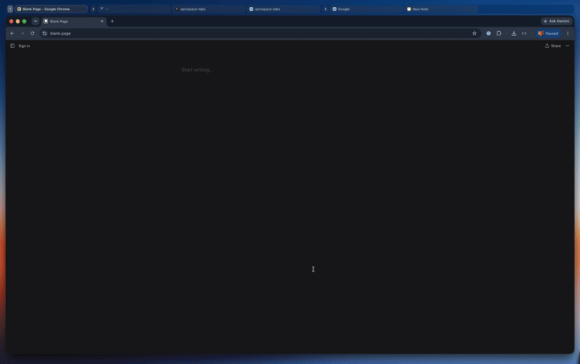

<div align="center">
  
  <h1>AeroSpaceTabs</h1>
  <p>A macOS companion for AeroSpace with a window tab strip and workspace-grouped overview</p>
  <p>
    <a href="https://github.com/pedrotmr/aerospace-tabs/releases/latest"></a>
    <a href="https://github.com/pedrotmr/aerospace-tabs/actions/workflows/ci.yml"></a>
    <a href="LICENSE"></a>
  </p>
</div>

[](Media/aerospace-tabs-demo.mp4)

[Open the full demo video (MP4)](Media/aerospace-tabs-demo.mp4).

## ✨ Features

AeroSpaceTabs adds a tab strip and a workspace overview to [AeroSpace](https://github.com/nikitabobko/AeroSpace). AeroSpace remains in control of window tiling.

- 🪟 **Window tabs.** A strip appears when a display has two or more windows. Click to focus or drag to reorder.
- 🧭 **Workspace overview.** Browse windows grouped by AeroSpace workspace.
- ⌨️ **Quick focus.** Use the keyboard, the default three-finger swipe, or a hot corner.

## 📦 Install

Choose one installation method:

### Option 1: Homebrew

```sh
brew install --cask pedrotmr/aerospace-tabs/pedrotmr-aerospace-tabs
```

Homebrew manages updates for this copy. To update only AeroSpaceTabs:

```sh
brew update
brew upgrade --cask --greedy-auto-updates pedrotmr/aerospace-tabs/pedrotmr-aerospace-tabs
```

### Option 2: Direct download

1. Download the latest stable [DMG or ZIP from GitHub Releases](https://github.com/pedrotmr/aerospace-tabs/releases/latest).
2. If you downloaded the DMG, open it. If you downloaded the ZIP, extract it.
3. Drag `AerospaceTabs.app` to your Applications folder.

To update a direct download, choose **Check for Updates…** in the app. Versions before v0.2.0 need one manual update first.

## 🚀 First launch

1. Install and start AeroSpace.
2. Open AeroSpaceTabs from Applications and allow **Accessibility** access when macOS asks.
3. Use the default three-finger swipe to open the overview. Move with the arrow keys, press Return to focus a window, or press Escape to close the overview.

## ⚙️ Requirements and limitations

- Requires macOS 14 or later, AeroSpace running, and Accessibility access. Screen Recording is optional for window previews.
- Temporarily changes AeroSpace's `gaps.outer.top` and normally restores the previous value on quit. See the [recovery guide](docs/usage.md) if needed.
- Trackpad swipe uses Apple's private `MultitouchSupport` framework and may change after macOS updates.
- Window previews stay in memory. The app does not save or send them, and it does not manage native macOS Spaces.

## 🛠 Development

Use Xcode 26.6 or later. These commands do not need signing or release credentials:

```sh
make setup
make run
make check
```

See the [build and release guide](docs/BUILD-AND-RELEASE.md) for tool and release details.

> Maintenance is best-effort. Issues and pull requests are welcome, but replies and release dates are not promised.

## Links

- 🐛 **Support:** [Report a problem](https://github.com/pedrotmr/aerospace-tabs/issues)
- 📚 **Documentation:** [Read the guides](docs/README.md)
- 🤝 **Contribute:** [Contribution guide](CONTRIBUTING.md)
- ⚖️ **License:** [MIT](LICENSE) · [Third-party notices](docs/THIRD-PARTY-NOTICES.md)
