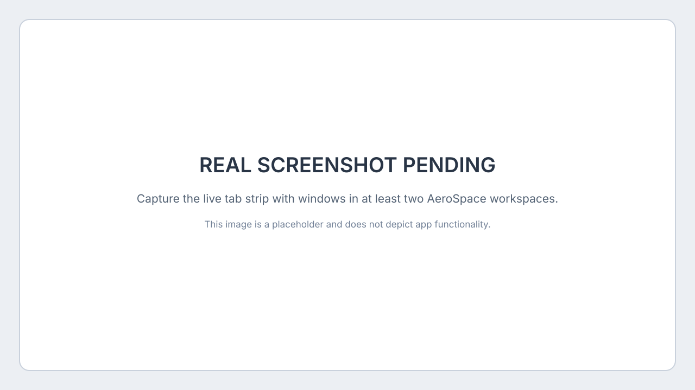

# Aerospace Tabs

<p align="center">
  
</p>

A small macOS companion for [AeroSpace](https://github.com/nikitabobko/AeroSpace). AeroSpace tiles windows; Aerospace Tabs adds a tab strip for finding and focusing them, plus a visual overview grouped by AeroSpace workspace.

> **Maintenance:** Development is paused. Issues and pull requests are welcome on a best-effort basis, but replies and new releases are not promised.



*This is a labeled placeholder, not a screenshot of the app. See [capture notes](docs/SCREENSHOT.md).*

## Quick start

1. Install and start [AeroSpace](https://github.com/nikitabobko/AeroSpace).
2. Install Aerospace Tabs:

   ```sh
   brew install --cask pedrotmr/aerospace-tabs/pedrotmr-aerospace-tabs
   ```

3. Open **Aerospace Tabs** from Applications. Allow **Accessibility** when macOS asks.
4. With two or more windows open on that display, right-click the strip and choose **Open Window Overview**. Use the arrow keys and Return to focus a window; Escape closes the overview.

Alternatively, add the tap once with `brew tap pedrotmr/aerospace-tabs`, then run `brew install --cask pedrotmr-aerospace-tabs`.

## What it does

- Lists AeroSpace windows from occupied workspaces on each display. The strip appears when that display has two or more windows.
- Click a tab to focus its window; drag to change its local order.
- Shows a full-screen overview grouped by workspace. Three-finger swipe opens it by default; an optional hot corner is available from the strip menu.
- Keeps AeroSpace responsible for tiling and layout.

## Requirements and limits

- macOS 14 or later, with AeroSpace installed and running.
- Accessibility enables global shortcuts and Dock notification badges. Screen Recording is optional and enables window previews.
- The app temporarily increases AeroSpace's `gaps.outer.top` while running, then restores it on quit. Recovery instructions are in [usage notes](docs/usage.md).
- Trackpad swipe detection uses macOS's private `MultitouchSupport` framework and may break after system updates. Window previews stay in memory and are not saved or sent off-device.
- This is not a window manager and does not manage native macOS Spaces.

## Help and development

Report a problem in [GitHub Issues](https://github.com/pedrotmr/aerospace-tabs/issues). See [contribution and build instructions](CONTRIBUTING.md), [project scope](CHARTER.md), and [Window Overview details](WINDOW-OVERVIEW.md). The project is MIT licensed.
